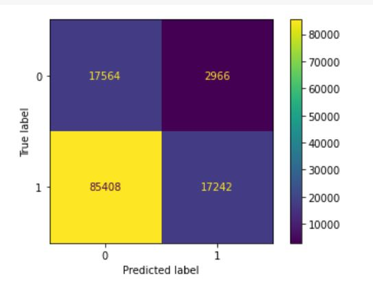
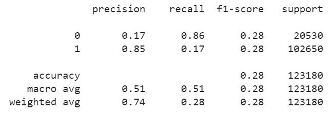
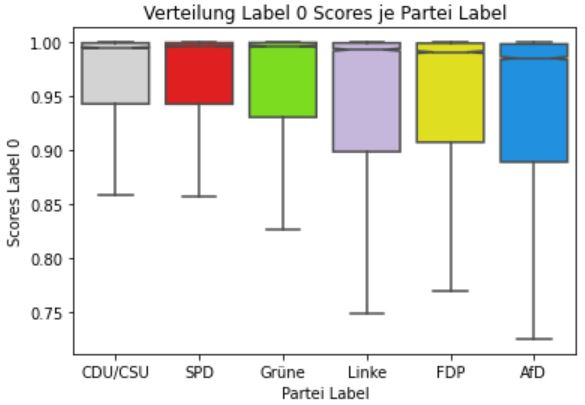
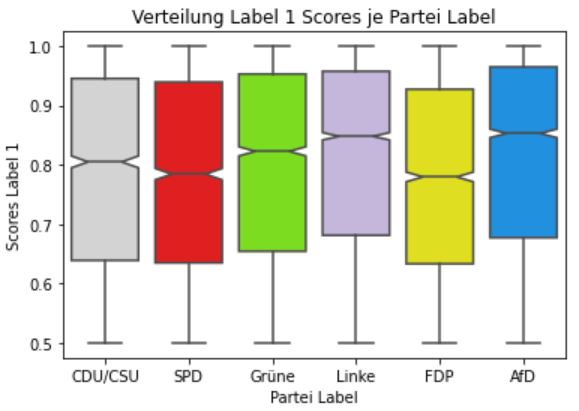
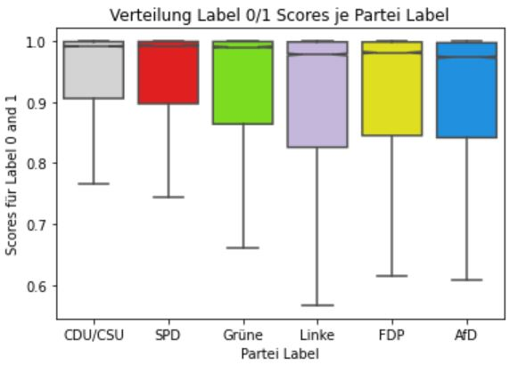
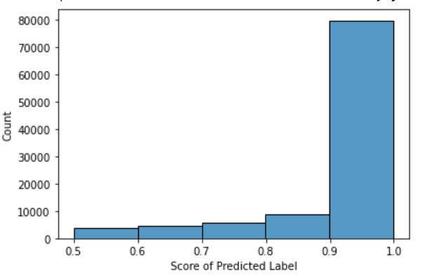
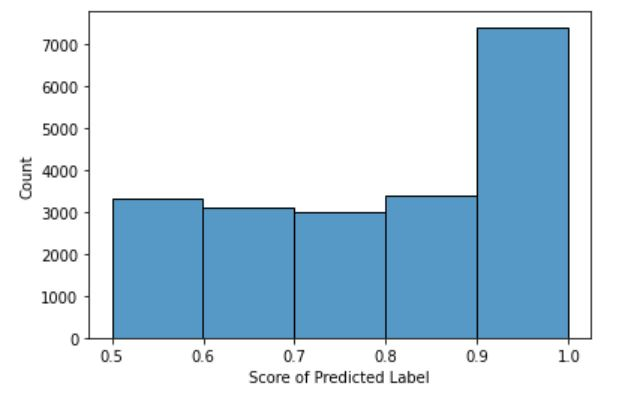
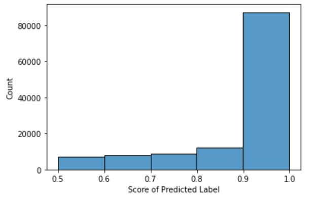

# NLP-Based Interactive Decision Aids: Evaluating LLM Predictions on Political Tweets

[](https://www.python.org/)
[](https://colab.research.google.com/)
[](https://huggingface.co/)
[](https://pandas.pydata.org/)
[]()

> **Portfolio Showcase:** This repository originates from my Master’s thesis in Business Administration (specializing in Marketing & Customer Insight) at the University of Hamburg. It demonstrates a complete end-to-end data analytics pipeline—ranging from web scraping unstructured social media data and advanced NLP preprocessing to model inference testing and critical performance evaluation.

---

## 🚀 Interactive Notebooks (Google Colab)

To bypass GitHub viewer limitations for Jupyter Notebooks, you can open and run the notebooks directly in Google Colab via the links below:

* **1. Data Scraping, Cleaning & Labeling:**  
  [](https://colab.research.google.com/github/jonmbab/political-tweet-sentiment-electra/blob/main/notebooks/01_scraping_cleaning_and_labeling.ipynb)

* **2. Descriptive Statistics & Sentiment Analysis:**  
  [](https://colab.research.google.com/github/jonmbab/political-tweet-sentiment-electra/blob/main/notebooks/02_descriptive_stats_and_analysis.ipynb)

---

## 🎯 Background & Marketing Context (The "Why")

Traditional decision aids in marketing (such as recommendation systems or attribute matrices) typically rely on structured product data and rigid questionnaires. 

* **The Research Core:** Can modern Natural Language Processing (NLP) and Large Language Models be leveraged to create interactive decision aids where users express their preferences freely in their own words?
* **The Marketing Transfer:** Political communication represents one of the most complex choice environments. Demonstrating how to analyze and structure unstructured political texts provides a methodological framework that translates directly to complex consumer decision-making in business (e.g., high-involvement financial services, automotive choices, or brand perception).

---

## 🔄 Data Pipeline & Methodology

This project covers the full data analytics lifecycle:

1. **Data Collection & Scraping:**
   * Automated extraction of **30,000 raw tweets** from **421 members of the German Bundestag (MdB)** across the 6 major political parties (CDU/CSU, SPD, Grüne, FDP, Die Linke, AfD) over a 63-day period using `snscrape` and `selenium`.
   * Automated scraping and regex mapping of politician profile bios to verify party affiliations.

2. **Advanced NLP Preprocessing & Feature Engineering:**
   * **Hashtag Segmentation (`hashformers`):** Resolved compound social media hashtags (e.g., `#klimaschutzgesetz` $\rightarrow$ individual words) using GPT-2/BERT rerankers to retain thematic context without information loss. *Note: As the original library lacked native TensorFlow support at the time, I successfully collaborated with the package maintainer to establish a dedicated TensorFlow branch for this project.*
   * **Text Cleaning:** Filtered out non-German tweets, duplicates, URLs, emojis, and short tweets ($<7$ words), reducing the dataset to **20,530 clean tweets**. Explicitly retained stop words to preserve crucial negation structures for sentiment and polarity.

3. **Model Inference & Single-Label Prefix Transformation:**
   * Utilized pre-trained German Transformer architectures (`ELECTRA` / `BERT`) via Hugging Face.
   * Transformed the dataset into single-label prefix formatting (evaluating each tweet against all 6 party prefixes), expanding the dataset to **123,180 evaluated instances**.

#### Sample Final DataFrame Output
The table below illustrates the transformed output structure, showing how a single input tweet is evaluated against candidate party prefixes to yield a predicted label, model confidence score, and sentiment:

| Username | Name | Party | Clean Text (Snippet) | Pred. Label | Score | Sentiment |
| :--- | :--- | :--- | :--- | :---: | :---: | :---: |
| BriHasselmann | Britta Haßelmann | Grüne | cdu/csu: Konsequent Handeln beim Klimaschutz h... | 1 | 0.617683 | negative |
| BriHasselmann | Britta Haßelmann | Grüne | spd: Konsequent Handeln beim Klimaschutz heißt... | 0 | 0.999397 | positive |
| BriHasselmann | Britta Haßelmann | Grüne | grüne: Konsequent Handeln beim Klimaschutz hei... | 0 | 0.999369 | positive |
| BriHasselmann | Britta Haßelmann | Grüne | die linke: Konsequent Handeln beim Klimaschutz... | 0 | 0.999392 | positive |
| BriHasselmann | Britta Haßelmann | Grüne | fdp: Konsequent Handeln beim Klimaschutz heißt... | 1 | 0.993188 | negative |
| BriHasselmann | Britta Haßelmann | Grüne | afd: Konsequent Handeln beim Klimaschutz heißt... | 1 | 0.996538 | negative |

*(👉 [View full DataFrame screenshot in assets/images](assets/images/final_dataframe.JPG))*

---

## 📊 Key Findings & Analytical Insights

### 1. Classification Performance & Evaluation Metrics
The combination of the confusion matrix and classification report provides a comprehensive view of the model's predictive behavior:

* **Confusion Matrix:**  
  

* **Classification Report:**  
  

* **Quantitative Breakdown & Interpretation:**
  * **Class 0:** Precision of 0.17, Recall of 0.86, F1-Score of 0.28 (17,564 True Negatives, 2,966 False Positives).
  * **Class 1:** Precision of 0.85, Recall of 0.17, F1-Score of 0.28 (17,242 True Positives, 85,408 False Negatives).
  * **Overall Accuracy:** 28% across 123,180 evaluated instances.
  * **Insight:** The model exhibits a strong conservative bias toward predicting Class 0, resulting in a high false-negative rate for Class 1. This underlying imbalance is the root cause of the seemingly low accuracy metric.

---

### 2. Model Confidence & Score Distributions
Despite the classification challenges reflected in the metrics, analyzing the model's prediction probabilities (scores) reveals extreme confidence patterns.

#### Boxplots (Distribution per Party)
* **Label 0 Scores:**  *(Medians remain extremely close to 1.0 across all parties, with minor lower outliers for AfD/Die Linke down to ~0.73)*
* **Label 1 Scores:**  *(Wider spread with medians stable around 0.80 to 0.85)*
* **Combined Scores:** 

#### Frequency Histograms (Overall Score Concentration)
The histograms illustrate the absolute frequency distribution of prediction scores across bins, confirming the massive concentration of high confidence values:

* **Histogram - Label 0 Scores:**  
    
  * *Insight:* The vast majority of Label 0 predictions cluster intensely in the highest confidence bin (0.9 to 1.0, representing ~80,000 instances).

* **Histogram - Label 1 Scores:**  
    
  * *Insight:* Label 1 scores show a more balanced spread across lower confidence bins (0.5 to 0.9), while still peaking heavily in the 0.9–1.0 bin (~7,000+ instances).

* **Histogram - Combined Scores (Label 0/1):**  
    
  * *Insight:* Roughly ~90,000 predictions reach the top confidence tier (>0.9), directly supporting the core finding of an average model confidence score of ~91%.

---

### 3. Core Insights & Marketing Implications
* **The Accuracy Paradox:** While the model achieved an overall accuracy of **28%** on hold-out data, deeper inspection revealed an average model confidence score of **~91%** across predictions.
* **Content Analysis & Root Cause:** Wordclouds and descriptive statistics proved that the low classification accuracy was driven by the **nature of the data itself** rather than model failure: politician tweets frequently contained general, everyday conversation and lacked sharp ideological differentiation between parties.
* **Marketing Implications:** The descriptive analysis revealed that politicians underutilized Twitter as a targeted communication and customer (voter) acquisition tool, often failing to establish clear brand differentiation.

---

## 🚀 Key Takeaways for Practice

This showcase highlights my ability to:
- Handle noisy, large-scale, unstructured web data and transform it into clean, analytics-ready structures.
- Execute advanced text preprocessing techniques (regex, custom hashtag segmentation, language detection).
- Go beyond surface-level metrics: critically investigate model behavior, confidence scores, and data limitations rather than treating ML outputs as black boxes.
- Bridge academic research with practical marketing analytics and strategic business insights.

---

## 🛠 Tech Stack

* **Environment:** Google Colab (GPU)
* **Programming Language:** Python
* **Data Manipulation & Analysis:** Pandas, NumPy, Scikit-Learn
* **NLP & Model Testing:** Hugging Face Transformers, PyTorch/TensorFlow, Hashformers
* **Data Extraction & Web Scraping:** Selenium, BeautifulSoup, Snscrape
* **Version Control:** Git & GitHub

---

## 📂 Repository Structure

```text
├── assets/                # Assets folder for documentation and plots
│   └── images/            # JPG/PNG plots for README visualization
├── data/                  # Anonymized sample input schema and data structure
├── notebooks/             # Google Colab notebooks (Scraping, Preprocessing, Inference & Evaluation)
├── src/                   # Reusable Python scripts for scraping, cleaning & hashtag segmentation
└── README.md              # Project documentation